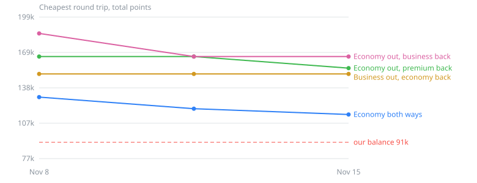

# Atmos Award Watch

[](https://github.com/XanderF98/atmos-award-watch/actions/workflows/tests.yml)

A daily watcher for award flights bookable with Alaska Atmos Rewards points, and a Model Context Protocol (MCP) server so an AI agent can answer questions about what it finds.

I built it for one trip: two of us, Seattle to Italy in October 2027, starting at Lake Como and ending near Naples, on about 91,000 points. Most award tools answer "is there a cheap seat on this route?". The question I actually had was different:

**Can we both get there and back, about ten days apart, and how many points are we short?**

So the watcher pairs every way out with a way back, prices the whole trip for two, and compares it with our balance.



*Sample output from made-up data. [The full sample dashboard](sample/README.md) shows everything a daily run writes.*

## What a daily run tells me

- **Whether the trip is bookable.** The cheapest pairing for each cabin mix (economy both ways, business out and economy back, and so on), total points for two, and how far that is from our balance.
- **Which dates exist yet.** Alaska opens award seats 330 days ahead, so for weeks some of our dates simply can't be booked. The run says which are open and when the rest will be, so "no seats" is never confused with "not released".
- **Whether the data covers our routes.** The data source mostly tracks airport pairs that have a nonstop flight. If a route returns nothing, the run says so instead of staying quiet forever.
- **Whether landing somewhere else is cheaper.** Rome and Milan side by side with Dublin, London, Paris, Helsinki and Reykjavik, and whether the saving beats the hassle of a separate hop to Italy.
- **One-way deals.** Seats at or under my points limit per cabin, with enough seats for both of us.

When a deal is new or gets cheaper, it opens a GitHub issue, which reaches me by email and phone.

## How it works

```
private results repo                         this public repo
--------------------                         ----------------
GitHub Actions (daily) -- runs --> watcher.py --HTTPS--> seats.aero API
   |
   |-- saves the dashboard, chart and price history (private)
   '-- opens an issue when a deal is new or cheaper (private)

my Copilot Studio agent --MCP--> server.py --> the saved results, or a live lookup
```

The code is public and the results are private. That split was not my first design. I started with one public repo that committed its findings every day. Then I read the data source's terms: API results for flights more than 60 days out can't be shown publicly. My whole trip is more than 60 days out. So the scheduled job now runs in a small private repo, the MCP server refuses to listen publicly without a key, and this repo only ever shows sample data.

`private-repo/` has the workflow file and the five-minute setup for the private side.

## What counts as a deal

All of this lives in `watchlist.json`. Points are per person, one way.

| Rule | Setting | Mine |
|---|---|---|
| Points at or under the limit for the cabin | `max_miles` | first 90,000, business 70,000, premium 50,000, economy 37,500 |
| Enough seats for everyone, when the count is known | `passengers` | 2 |
| Taxes under a cap, when known and in US dollars | `max_taxes_usd` | 350 |
| A detour must save enough to be worth it | `detours` | Vancouver or Portland must save 20,000 points over Seattle; Dublin, London, Paris or Helsinki 10,000 over Italy; Reykjavik 15,000 |
| Trip length when pairing out and back | `trip.min_nights`, `trip.max_nights` | 8 to 12 nights |
| Points we have | `points_balance` | 91,000 |

## Flying into another European city

Atmos prices partner awards by the total distance of the one-way trip. Seattle to Dublin, London, Reykjavik or Helsinki falls in the 3,501 to 5,000 mile band. Anything that ends in Italy, or connects on to it, goes over 5,000 miles. Per person, one way:

| Band | Economy | Business |
|---|---|---|
| 3,501 to 5,000 miles (Seattle to Dublin, London, Reykjavik, Helsinki) | 27,500 | 55,000 |
| 5,001 to 7,000 miles (Seattle to Italy, or Frankfurt) | 35,000 | 70,000 |

So landing in Dublin and booking the short hop to Italy separately can save 7,500 points per person each way in economy and 15,000 in business. Booking the hop on the same award doesn't save anything, because the connection counts toward the distance. It does buy a free stopover of up to 14 days in that city.

Each gateway is a detour in `watchlist.json`, with the saving it has to beat and how you'd get to Italy from it:

```json
"DUB": {"name": "Dublin", "min_savings": 10000, "connection": "a 2.5 to 3 hour flight to or from Italy"}
```

Which cities are worth watching depends on what the data source covers. On November 15, 2026, seats.aero tracked Seattle to and from Rome, Dublin, London, Paris, Helsinki and Reykjavik for Atmos, but not Milan or Naples. That makes Rome the only Italian airport the watcher can see. Our trip starts at Lake Como, so landing in Rome means a 3 hour train north, which makes Dublin, London and Paris look even better. Vancouver and Portland are only tracked to London and Reykjavik.

I set the bar at 10,000 points because a budget flight to Milan plus half a day costs about that much to me. That means a business-class saving clears it and an economy saving doesn't. Frankfurt is left out because it is just over 5,000 miles from Seattle, so it costs the same as Italy.

## MCP tools

| Tool | What it answers | Cost |
|---|---|---|
| `get_trip_options` | Can we book the whole trip, how many points are we short, and is it cheaper to land elsewhere? | Free |
| `get_current_deals` | What one-way deals did the latest check find? | Free |
| `get_price_history` | Is this a good price compared with recent checks? | Free |
| `get_watchlist` | What is being watched, and under what rules? | Free |
| `search_awards` | What about a route or dates I'm not watching? | 1 API call |
| `get_flight_details` | Which flights, when, and where do I book? | 1 API call |

The descriptions tell the agent which tools are free and which spend quota, so it reads the saved results first.

## Try it

Requires Python 3.10 or newer. The watcher itself uses only the standard library.

```
python watcher.py --demo          # sample data, no key, prints the dashboard
python -m pytest                  # 37 tests, run against a local stand-in for the API
```

With a seats.aero Pro API key in `SEATS_AERO_API_KEY`:

```
python watcher.py --check-routes  # run this first: is each of my routes covered?
python watcher.py                 # a real check; results go to data/ (ignored by git)
pip install -r requirements.txt && python server.py    # MCP endpoint at http://localhost:8000/mcp
```

## Hosting the MCP server

| Variable | Purpose |
|---|---|
| `SEATS_AERO_API_KEY` | Needed for the two live tools |
| `MCP_API_KEY` | A long random string. Required for the server to listen publicly; callers send it in an `X-API-Key` header |
| `DATA_BASE_URL` | Where the saved results live, e.g. `https://raw.githubusercontent.com/<you>/<private-repo>/main` |
| `DATA_TOKEN` | A read-only GitHub token for that private repo |
| `LIVE_CALL_DAILY_LIMIT` | Optional cap on live lookups per day (default 50) |

In Copilot Studio, add the server as a Model Context Protocol tool with API key authentication, sent as a header named `X-API-Key`.

## Design choices

- **Answer the trip question.** One-way deals are an ingredient. `trip.py` turns them into the thing I need to decide: a pairing, a total and a gap.
- **Make silence mean something.** A watcher that says nothing is indistinguishable from a broken one. Every run reports released dates and route coverage, so quiet has a reason.
- **Results stay private, by default and by design.** Without `MCP_API_KEY` the server binds to this computer only.
- **The scheduled job and the agent are separate.** Alerts depend only on GitHub and the data source. The agent is a way to ask questions, not a point of failure.
- **One rule for every detour.** A backup airport near home and a European gateway are the same idea: an airport I'd rather not use unless it saves enough. One `detours` setting covers both, and a flight using two detours has to beat both amounts.
- **Rules are plain, tested functions.** `deals.py` and `trip.py` have no network or file access, so each rule has a test.
- **Protect the quota.** The API key allows 1,000 calls a day. A run uses about 2 to 7, and the server caches lookups and caps live calls.
- **Alert once.** A deal alerts when it appears or gets cheaper, and again if it disappears and comes back.

## Limitations

- **Not yet proven on live data.** Everything is tested against a stand-in built from the published API spec. The first real runs will show what differs. I expect taxes (which I treat as cents) and route coverage to be the surprises.
- **Coverage is not guaranteed.** Routes without a nonstop flight may not be tracked at all, which is why Milan and Naples aren't in the watchlist. `--check-routes` and the coverage section of the dashboard exist because of this.
- **Cached data.** Results can be hours old, so a seat can be gone by the time I look. The airline's site is the final word.
- **The hop to Italy is my own problem.** The watcher prices the long flight. The short flight or train is booked separately, so a late arrival isn't protected. I'd leave a night in the gateway city.
- **October is the end of the season.** Several Seattle nonstops are seasonal. Alaska's Rome flights ran through October 23 in 2026, so late-October return dates may not have a nonstop.
- **One program.** Atmos Rewards only.
- **Points only.** Google Flights price alerts already cover cash fares.

## Credits

Award availability comes from [seats.aero](https://seats.aero), used under its terms for personal, non-commercial projects. This project is not affiliated with seats.aero or Alaska Airlines.

I built this as a learning project, with Claude as a coding assistant for the code and tests. The trip, the rules and the decisions are mine.
