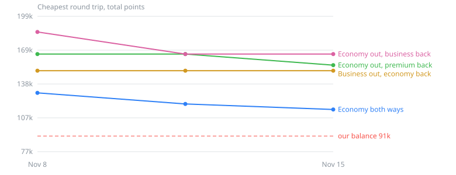

# Sample dashboard (made-up data)

Checked 2026-11-15 14:02 UTC for 2 traveler(s). Award data from [seats.aero](https://seats.aero); it is cached, so confirm on alaskaair.com before acting.

## Can we book the whole trip?

| Option | Out | Back | Nights | Points for 2 | Taxes | Against 91,000 |
|---|---|---|---|---|---|---|
| Economy both ways | Oct 3 SEA-MXP (economy, 27,500, connecting) | Oct 12 FCO-SEA (economy, 30,000, nonstop) | 9 | 115,000 | $294 | 24,000 short |
| Business out, economy back | Oct 2 YVR-MXP (business, 45,000, connecting) | Oct 12 FCO-SEA (economy, 30,000, nonstop) | 10 | 150,000 | $378 | 59,000 short |
| Economy out, premium back | Oct 3 SEA-MXP (economy, 27,500, connecting) | Oct 12 FCO-SEA (premium, 50,000, nonstop) | 9 | 155,000 | $294 | 64,000 short |
| Business out, premium back | Oct 2 YVR-MXP (business, 45,000, connecting) | Oct 12 FCO-SEA (premium, 50,000, nonstop) | 10 | 190,000 | $378 | 99,000 short |
| Economy out, business back | Oct 3 SEA-MXP (economy, 27,500, connecting) | Oct 12 FCO-SEA (business, 85,000, nonstop) | 9 | 225,000 | $294 | 134,000 short |
| Economy out, first back | Oct 3 SEA-MXP (economy, 27,500, connecting) | Oct 14 NAP-SEA (first, 90,000, connecting) | 11 | 235,000 | $352 | 144,000 short |

## Which dates can be booked yet?

- **Seattle to Italy:** 12 of 16 dates can be booked (through Oct 12). Oct 13 opens Nov 16; all are open by Nov 19.
- **Italy to Seattle:** 3 of 19 dates can be booked (through Oct 12). Oct 13 opens Nov 16; all are open by Dec 1.

## Is the data source covering our routes?

- **Seattle to Italy:** data for SEA-MXP, SEA-LIN, YVR-MXP, PDX-MXP. Nothing returned for SEA-FCO, YVR-LIN, YVR-FCO, PDX-LIN, PDX-FCO.
- **Italy to Seattle:** data for NAP-SEA, FCO-SEA. Nothing returned for NAP-YVR, NAP-PDX, FCO-YVR, FCO-PDX.

A route with nothing returned is usually one seats.aero does not track, not one that is sold out.

## Cheapest one-way price by cabin

**Seattle to Italy** (4 deals meeting the rules)

| Cabin | Points each | On | Route | Days with space |
|---|---|---|---|---|
| Business | 45,000 | Oct 2 | YVR-MXP | 5 |
| Economy | 27,500 | Oct 3 | SEA-MXP | 2 |

**Italy to Seattle** (3 deals meeting the rules)

| Cabin | Points each | On | Route | Days with space |
|---|---|---|---|---|
| First | 90,000 | Oct 14 | NAP-SEA | 1 |
| Business | 85,000 | Oct 12 | FCO-SEA | 1 |
| Premium | 50,000 | Oct 12 | FCO-SEA | 1 |
| Economy | 30,000 | Oct 12 | FCO-SEA | 1 |

